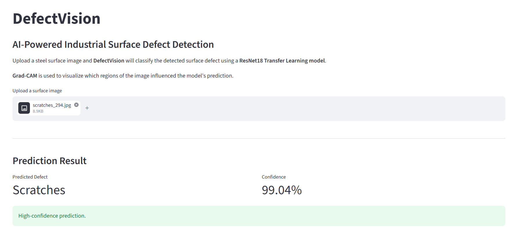
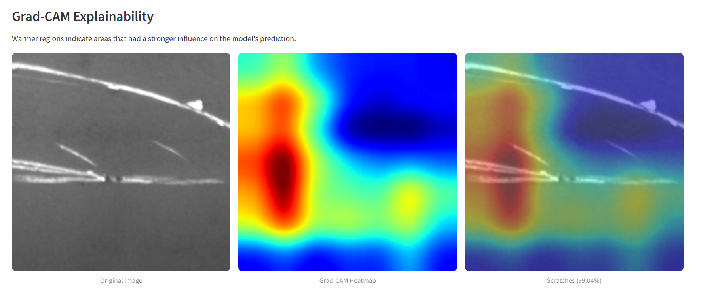
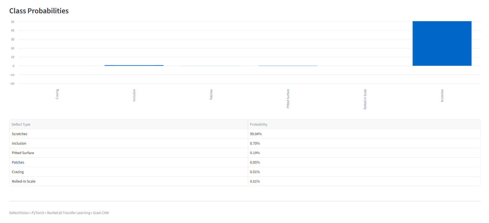
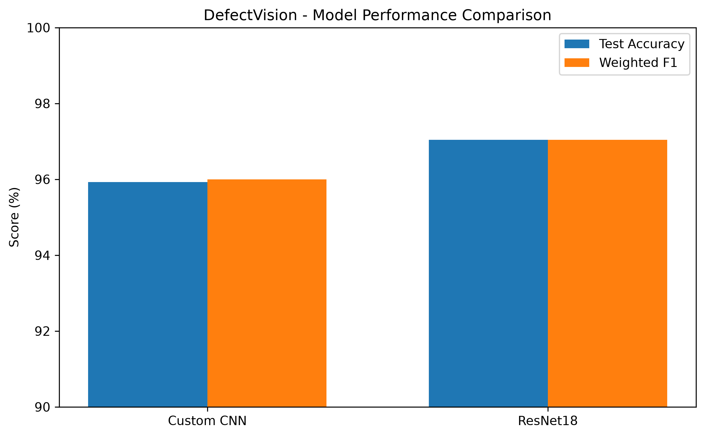
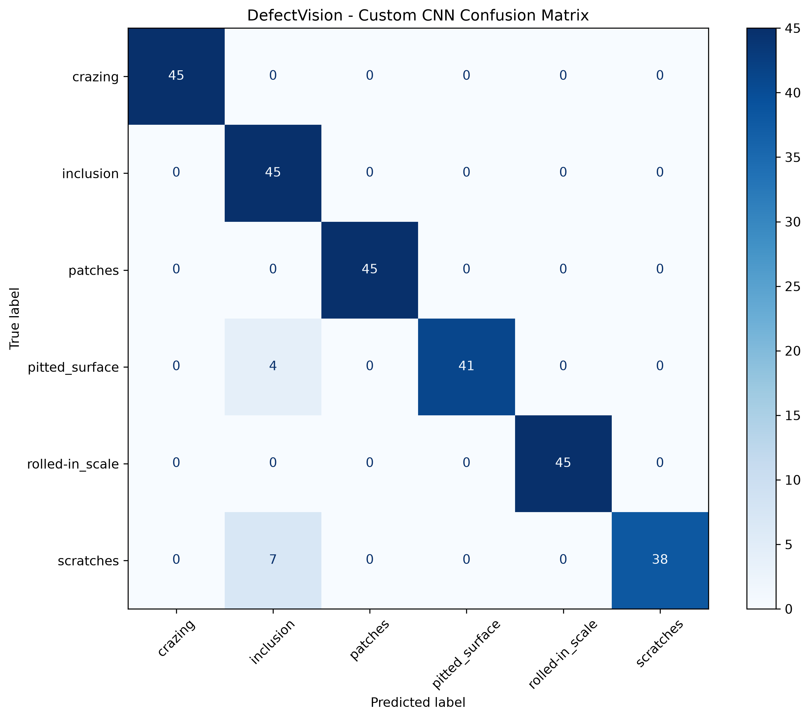
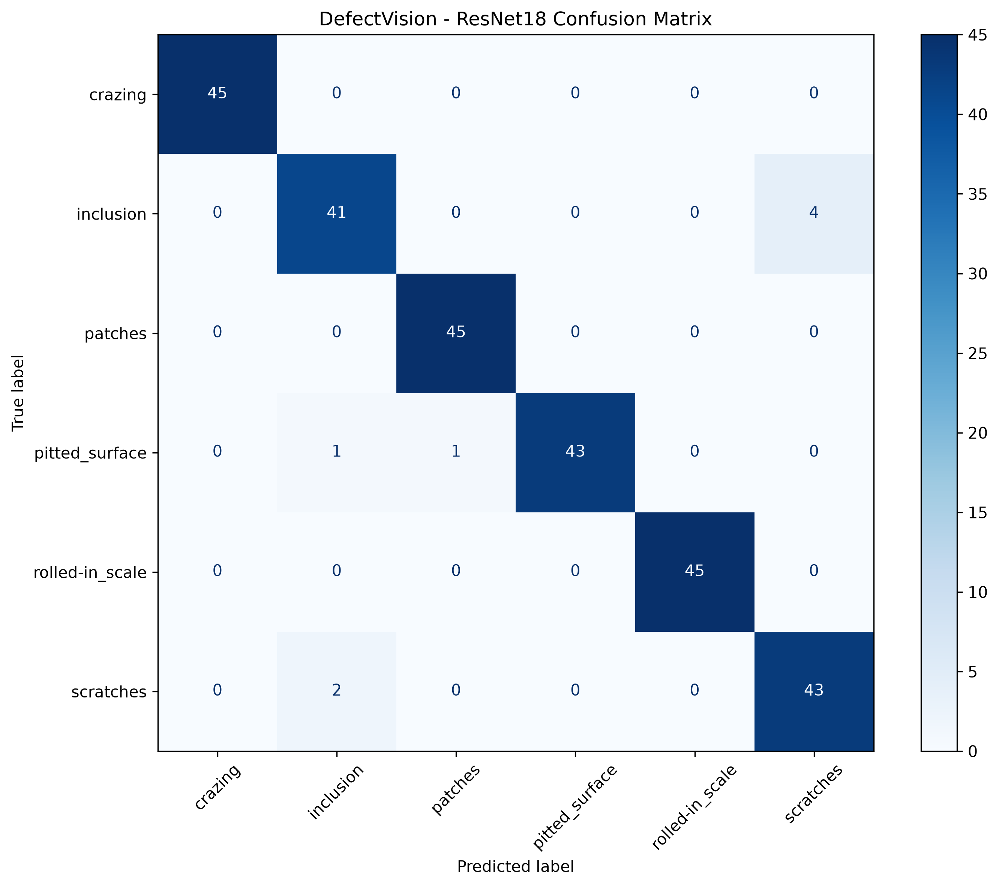
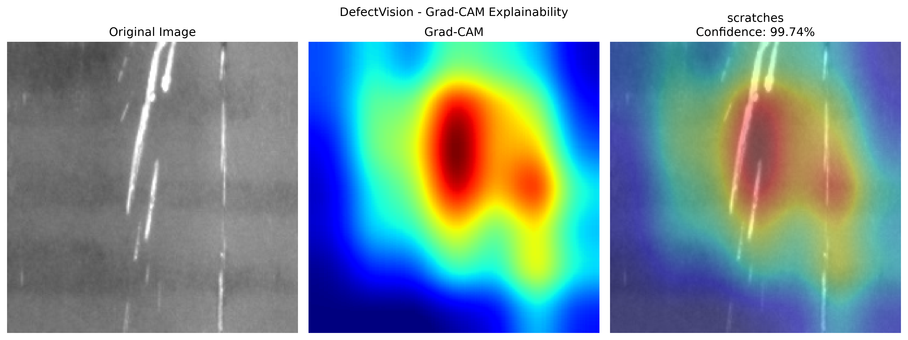

# DefectVision

**PyTorch, ResNet18 Transfer Learning ve Grad-CAM kullanılarak geliştirilen yapay zekâ destekli endüstriyel yüzey hata sınıflandırma projesi.**

DefectVision, çelik yüzey görüntülerindeki hata türlerini sınıflandırır ve modelin karar verirken görüntünün hangi bölgelerine odaklandığını Grad-CAM ile görselleştirir.

---

## Proje Hakkında

Bu projenin amacı, endüstriyel çelik yüzeylerde bulunan farklı hata türlerini derin öğrenme yöntemleriyle sınıflandırmaktır.

Proje kapsamında iki farklı yaklaşım geliştirilmiş ve karşılaştırılmıştır:

- Sıfırdan geliştirilen Custom CNN
- ResNet18 + Transfer Learning

Sonuçlara göre ResNet18 tabanlı Transfer Learning yaklaşımı daha yüksek test başarımı göstermiştir.

Ayrıca modelin verdiği kararların daha yorumlanabilir olması için Grad-CAM entegrasyonu yapılmıştır.

---

## Uygulama

### Tahmin Ekranı



### Grad-CAM Görselleştirmesi



### Sınıf Olasılıkları



---

## Veri Seti

Projede **NEU Surface Defect Database** kullanılmıştır.

Veri setinde toplam **1.800 çelik yüzey görüntüsü** ve 6 farklı hata sınıfı bulunmaktadır.

| Hata Sınıfı | Görüntü Sayısı |
|---|---:|
| Crazing | 300 |
| Inclusion | 300 |
| Patches | 300 |
| Pitted Surface | 300 |
| Rolled-in Scale | 300 |
| Scratches | 300 |

Veri seti şu şekilde ayrılmıştır:

| Veri Bölümü | Görüntü Sayısı | Oran |
|---|---:|---:|
| Train | 1260 | %70 |
| Validation | 270 | %15 |
| Test | 270 | %15 |

Sınıf dağılımının korunması için **stratified split** kullanılmıştır.

---

## Kullanılan Modeller

### 1. Custom CNN

PyTorch kullanılarak sıfırdan bir Convolutional Neural Network mimarisi geliştirilmiştir.

Modelde kullanılan temel bileşenler:

- Convolutional Layers
- Batch Normalization
- ReLU
- Max Pooling
- Adaptive Average Pooling
- Dropout
- Fully Connected Layer

---

### 2. ResNet18 + Transfer Learning

ImageNet üzerinde önceden eğitilmiş **ResNet18** modeli kullanılmıştır.

İlk aşamada modelin feature extraction katmanları dondurulmuş ve son classification katmanı veri setindeki 6 sınıfa göre yeniden düzenlenmiştir.

Bu sayede modelin daha önce öğrendiği kenar, şekil ve doku gibi genel görsel özelliklerden yararlanılmıştır.

---

## Model Sonuçları

| Model | Test Accuracy | Weighted F1 Score |
|---|---:|---:|
| Custom CNN | %95.93 | 0.9600 |
| ResNet18 | **%97.04** | **0.9704** |

ResNet18 tabanlı Transfer Learning modeli test setinde daha yüksek performans göstermiştir.

### Model Karşılaştırması



---

## Confusion Matrix

### Custom CNN



### ResNet18



ResNet18 modeli, test setindeki **270 görüntünün 262 tanesini doğru sınıflandırmıştır.**

Modelin hata yaptığı örnekler ağırlıklı olarak şu sınıflar arasında görülmüştür:

- Inclusion
- Scratches
- Pitted Surface

---

## Grad-CAM ve Açıklanabilir Yapay Zekâ

Modelin yalnızca tahmin üretmesi yerine, bu tahmini hangi görüntü bölgelerine bakarak oluşturduğunu göstermek amacıyla **Grad-CAM** kullanılmıştır.



Sıcak renklerle gösterilen bölgeler, modelin karar verirken daha fazla önem verdiği alanları temsil eder.

> Grad-CAM piksel seviyesinde segmentasyon yapmaz. Modelin kararını etkileyen yaklaşık bölgeleri görselleştirir.

---

## Streamlit Arayüzü

Proje için Streamlit kullanılarak basit bir kullanıcı arayüzü geliştirilmiştir.

Kullanıcı:

- Çelik yüzey görüntüsü yükleyebilir
- Tahmin edilen hata sınıfını görüntüleyebilir
- Model confidence değerini görebilir
- Grad-CAM heatmap çıktısını inceleyebilir
- Tüm sınıflara ait tahmin olasılıklarını görebilir

---

## Kullanılan Teknolojiler

- Python
- PyTorch
- Torchvision
- CNN
- ResNet18
- Transfer Learning
- Grad-CAM
- Scikit-learn
- Matplotlib
- Pandas
- NumPy
- Streamlit
- Pillow

---

## Proje Yapısı

```text
DefectVision/
│
├── data/
│   ├── raw/
│   └── processed/
│
├── models/
│   ├── custom_cnn_best.pth
│   └── resnet18_best.pth
│
├── results/
│   ├── app_prediction.png
│   ├── app_gradcam.png
│   ├── app_probabilities.png
│   ├── custom_cnn_confusion_matrix.png
│   ├── resnet18_confusion_matrix.png
│   ├── model_comparison.png
│   └── resnet18_gradcam.png
│
├── src/
│   ├── explore_dataset.py
│   ├── visualize_dataset.py
│   ├── split_dataset.py
│   ├── data_loader.py
│   ├── model.py
│   ├── train.py
│   ├── evaluate.py
│   ├── resnet_model.py
│   ├── train_resnet.py
│   ├── evaluate_resnet.py
│   ├── compare_models.py
│   └── gradcam.py
│
├── app.py
├── requirements.txt
├── .gitignore
└── README.md